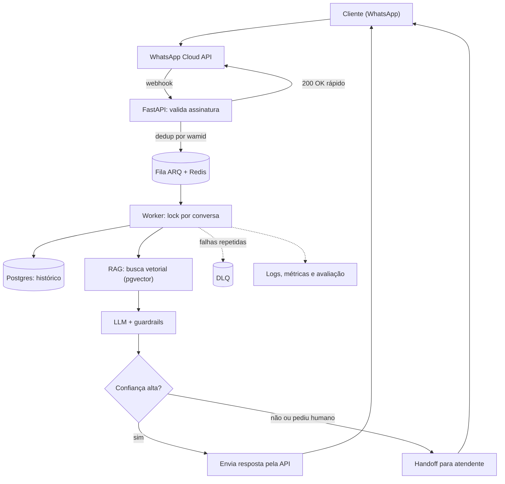
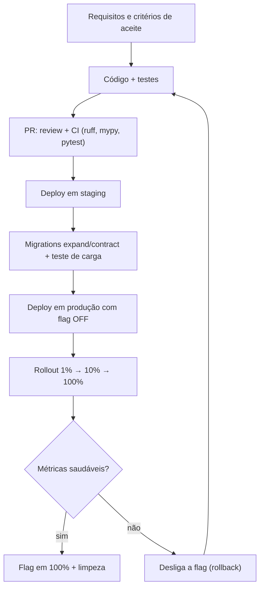
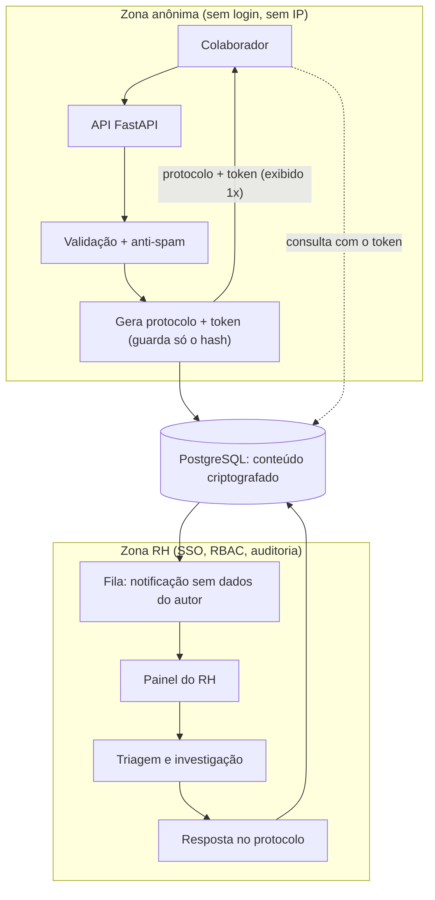

# Respostas: Avaliação Técnica

Respostas às três perguntas sobre chatbot de WhatsApp, entrega de features em produção e ouvidoria anônima de RH. A stack dos exemplos é Python.

## Sumário

1. [Chatbot de WhatsApp](#1-chatbot-de-whatsapp)
2. [Feature em produção](#2-garantindo-que-uma-feature-funcione-em-produção)
3. [Ouvidoria anônima de RH](#3-ouvidoria-anônima-de-rh)

---

## 1. Chatbot de WhatsApp

### Resposta resumida

Eu usaria a **WhatsApp Cloud API** com um webhook em **FastAPI** que só valida a assinatura, deduplica a mensagem e responde 200 rápido. O processamento acontece fora do request, em workers (**ARQ + Redis**), que carregam o histórico, buscam contexto na base de conhecimento (**RAG com pgvector**) e chamam o LLM com guardrails. Se a confiança for baixa ou o cliente pedir, a conversa vai para um atendente humano.

Os principais pontos de atenção em produção são:
- **Regras do canal:** janela de 24h e templates aprovados.
- **Confiabilidade:** idempotência, ordem das mensagens e resiliência (retry, DLQ).
- **Qualidade e segurança:** alucinação, prompt injection e LGPD.
- **Operação:** custo, latência e observabilidade, com avaliação contínua das conversas.

### Stack e justificativa

| Camada | Escolha | Por quê |
|---|---|---|
| Canal | WhatsApp Cloud API (Meta) | API oficial, sem risco de bloqueio de número |
| Webhook | FastAPI | Async nativo, validação com Pydantic |
| Fila | ARQ + Redis | Responder 200 rápido e processar fora do request |
| Estado | PostgreSQL + pgvector | Histórico e busca vetorial no mesmo banco |
| IA | SDK do LLM + RAG | Respostas ancoradas na base de conhecimento |

### Arquitetura



### Webhook (validação, idempotência e fila)

```python
import hmac, hashlib
from fastapi import FastAPI, Request, HTTPException, Header

app = FastAPI()

def assinatura_valida(body: bytes, header: str | None) -> bool:
    if not header:
        return False
    esperado = "sha256=" + hmac.new(APP_SECRET.encode(), body, hashlib.sha256).hexdigest()
    return hmac.compare_digest(esperado, header)

@app.post("/webhook")
async def webhook(request: Request, x_hub_signature_256: str | None = Header(None)):
    body = await request.body()
    if not assinatura_valida(body, x_hub_signature_256):
        raise HTTPException(status_code=403)

    for msg in extrair_mensagens(await request.json()):
        # idempotência: a Meta reenvia o webhook se demorar
        if await redis.set(f"wamid:{msg['id']}", 1, nx=True, ex=86400):
            await fila.enqueue_job("processar_mensagem", msg)
    return {"status": "ok"}
```

### Worker (RAG, handoff e resposta)

```python
async def processar_mensagem(ctx, msg: dict):
    telefone = msg["from"]
    texto = msg["text"]["body"]

    # lock por conversa garante a ordem das mensagens
    async with ctx["redis"].lock(f"conv:{telefone}", timeout=60):
        historico = await carregar_historico(telefone, limite=10)
        trechos = await retriever.buscar(texto, k=4)

        resposta = await llm.responder(
            system=SYSTEM_PROMPT,
            contexto=trechos,
            historico=historico,
            pergunta=texto,
        )

        if resposta.confianca < 0.6 or resposta.pede_humano:
            return await transferir_para_humano(telefone, historico)

        await whatsapp.enviar_texto(telefone, resposta.texto)
        await salvar_turno(telefone, texto, resposta.texto)
```

### Pontos de atenção em produção

- **Janela de 24h:** fora dela só é possível enviar template aprovado. O worker checa isso antes de enviar.
- **Idempotência e ordem:** deduplicação pelo `wamid` e lock por conversa.
- **Resiliência:** retry com backoff (tenacity), DLQ e circuit breaker no provedor de LLM.
- **Alucinação:** responder só com base no contexto recuperado, citar a fonte e recusar quando não souber.
- **Prompt injection:** conteúdo recuperado e mensagem do usuário entram como dados, nunca como instrução. As tools têm allowlist e escopo mínimo.
- **LGPD:** consentimento, mascaramento de CPF e telefone nos logs, retenção definida e direito de exclusão.
- **Custo e latência:** cache de respostas frequentes, modelo menor para intents simples e limite de tokens.
- **Observabilidade:** OpenTelemetry e Sentry, com `correlation_id` por conversa.
- **Qualidade contínua:** conjunto de conversas de referência rodando no CI, com métricas de acerto, taxa de handoff, CSAT e custo por conversa.

---

## 2. Garantindo que uma feature funcione em produção

### Resposta resumida

Eu trato a produção como o último ambiente de teste, não o primeiro. O caminho é:
1. **Requisitos:** critérios de aceite claros antes de codar.
2. **Testes:** unitários e de integração com serviços reais, rodando no CI junto com lint, tipagem e análise de segurança.
3. **Staging:** ambiente parecido com produção e migrations testadas.
4. **Deploy:** a feature sobe atrás de uma **feature flag** desligada, com rollout gradual (1%, 10%, 100%) e métricas e alertas prontos desde o início.

Se algo degradar, o rollback é desligar a flag, sem novo deploy. Depois acompanho erro, latência e métrica de negócio nas primeiras horas.

### Caminho até a produção



### Feature flag com rollout gradual

```python
import hashlib

def flag_ativa(nome: str, usuario_id: str, percentual: int) -> bool:
    # bucket estável: o mesmo usuário sempre cai no mesmo grupo
    h = int(hashlib.sha256(f"{nome}:{usuario_id}".encode()).hexdigest(), 16)
    return (h % 100) < percentual

@router.post("/pedidos")
async def criar_pedido(body: PedidoIn, user=Depends(usuario_atual)):
    if flag_ativa("novo_fluxo_pedido", user.id, settings.ROLLOUT_NOVO_FLUXO):
        return await novo_fluxo(body, user)
    return await fluxo_antigo(body, user)
```

### Passos

1. **Requisitos claros:** critérios de aceite e casos de borda definidos antes de codar.
2. **Testes:** `pytest` (unitários), `hypothesis` nos casos de borda e testes de integração com `testcontainers` (Postgres e Redis reais, não mocks).
3. **CI:** `ruff`, `mypy`, `bandit` e `pip-audit`. O merge só acontece com tudo verde, após code review.
4. **Staging** com volume de dados parecido com o de produção e teste de carga (Locust) nos fluxos críticos.
5. **Migrations seguras (Alembic):** padrão expand/contract. Primeiro adiciono a coluna, depois migro o código e só então removo a antiga. Assim o rollback do código nunca quebra o schema.
6. **Feature flag:** a feature sobe desligada e o rollout é gradual. O rollback é desligar a flag, sem novo deploy.
7. **Observabilidade antes do deploy:** métricas, alertas e dashboard da feature já criados, além de um runbook curto.
8. **Pós-deploy:** acompanho taxa de erro, latência e métrica de negócio nas primeiras horas, comparando com o baseline. Se algo falhar, faço um post-mortem sem culpados.

---

## 3. Ouvidoria anônima de RH

### Resposta resumida

O colaborador envia a denúncia por um formulário **sem login**. A API valida e filtra spam (rate limit e captcha) **sem registrar IP nem metadados**, gera um **protocolo** e um **token** aleatório e devolve os dois uma única vez. O conteúdo é salvo **criptografado** e só o **hash** do token fica no banco, então nem o RH consegue ligar o caso a uma pessoa.

O RH é notificado sem nenhum dado do autor e trabalha em um painel com SSO, controle de acesso por perfil e **auditoria** de quem abriu cada caso. Ele faz a triagem (com sugestão automática de categoria e gravidade, sempre revisada por uma pessoa), investiga e responde no protocolo. O colaborador acompanha e responde de forma anônima usando o token.

### Princípio

O sistema nunca guarda o que identificaria o autor. O banco guarda apenas o **hash** do token, então nem o RH consegue ligar a denúncia a uma pessoa.

### Fluxo de dados



### Implementação

```python
import hmac, secrets, hashlib
from cryptography.fernet import Fernet
from fastapi import APIRouter, Depends, Header, HTTPException

router = APIRouter()
fernet = Fernet(settings.CHAVE_CONTEUDO)  # vem de KMS/secret manager

def novo_acesso() -> tuple[str, str, str]:
    protocolo = secrets.token_hex(4).upper()
    token = secrets.token_urlsafe(32)
    return protocolo, token, hashlib.sha256(token.encode()).hexdigest()

@router.post("/denuncias", status_code=201)
async def criar(body: DenunciaIn, db: AsyncSession = Depends(get_db)):
    protocolo, token, token_hash = novo_acesso()
    db.add(Denuncia(
        protocolo=protocolo,
        token_hash=token_hash,
        categoria=body.categoria,
        conteudo=fernet.encrypt(body.texto.encode()),
    ))
    await db.commit()
    await fila.enqueue_job("notificar_rh", protocolo)  # sem dados do autor
    return {"protocolo": protocolo, "token": token}    # exibido uma única vez

@router.get("/denuncias/{protocolo}")
async def consultar(protocolo: str, x_token: str = Header(...), db=Depends(get_db)):
    d = await db.scalar(select(Denuncia).where(Denuncia.protocolo == protocolo))
    h = hashlib.sha256(x_token.encode()).hexdigest()
    if not d or not hmac.compare_digest(d.token_hash, h):
        raise HTTPException(status_code=404)  # mesma resposta nos dois casos
    return {"status": d.status, "respostas": d.respostas_publicas}
```

### Decisões de anonimato e segurança

- **Sem rastros:** `uvicorn --no-access-log`, proxy e WAF com log de IP e user-agent desligado, e remoção de EXIF dos anexos (Pillow).
- **Rate limit sem identificar:** chave no Redis com hash do IP + sal rotativo e TTL curto. Nada disso vai para o banco.
- **Painel do RH:** SSO, RBAC e trilha de auditoria registrando quem do RH abriu cada caso.
- **Triagem assistida:** um classificador (NLP/LLM) sugere categoria e gravidade, e uma pessoa sempre revisa. Casos graves disparam alerta imediato.
- **Reidentificação pelo texto:** o formulário avisa que detalhes muito específicos podem expor o autor, e o RH recebe orientação para tratar isso com cuidado.
- **Criptografia:** TLS em trânsito e Fernet em repouso, com a chave fora do banco.
- **LGPD:** base legal, retenção definida, acesso restrito e política explícita contra retaliação.
