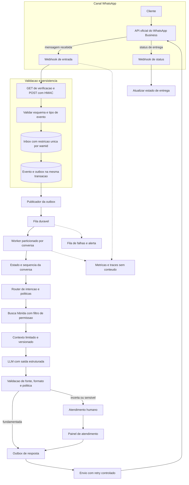
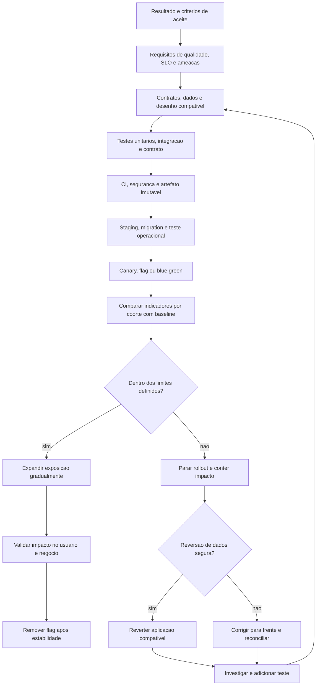
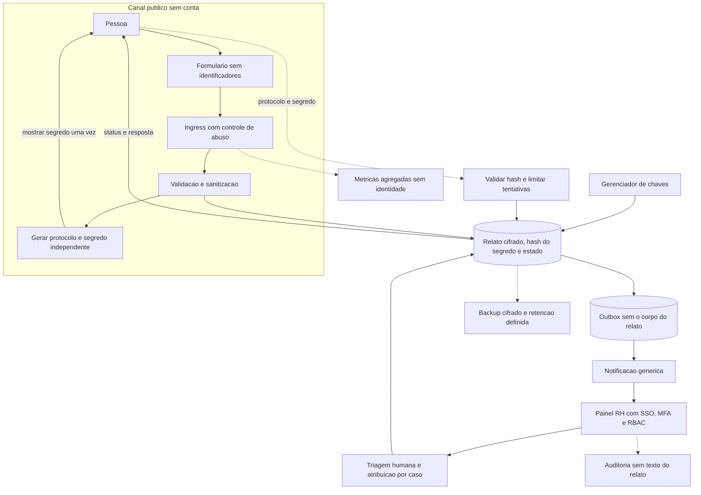

  <h1>Respostas à avaliação técnica</h1>
  
<strong>Arquitetura de software, inteligência artificial e sistemas em produção</strong>

> Esta proposta explica como eu delimitaria os problemas, escolheria soluções proporcionais e reduziria riscos, sem tratar tecnologias específicas como respostas automáticas.

## Navegação

1. [Chatbot de WhatsApp](#chatbot)
2. [Feature em produção](#feature)
3. [Ouvidoria anônima de RH](#ouvidoria)

## 1. Chatbot de WhatsApp

### Como eu decomporia o problema

Eu não começaria pelo modelo de linguagem. Primeiro entenderia quais tarefas o bot deve resolver, quais informações pode consultar, quais ações pode executar, quando precisa transferir para uma pessoa e como o negócio mede sucesso. Um FAQ de poucas perguntas pode ser mais confiável e barato com respostas determinísticas; um LLM passa a fazer sentido quando a linguagem é variada ou quando é preciso sintetizar informações autorizadas. Em geral, combinaria os dois: fluxos determinísticos para intenções e ações bem definidas, e geração com recuperação de conhecimento para perguntas abertas dentro de um escopo controlado.

Também definiria desde o início o que significa “resolver”: resposta entregue não é o mesmo que problema resolvido. Eu mediria resolução, reabertura, transferência para humano, satisfação, latência, custo e taxa de respostas sem suporte. Esses indicadores ajudam a decidir se uma automação está realmente melhorando o atendimento ou apenas reduzindo contatos humanos.

### Arquitetura e caminho de uma mensagem

Usaria a API oficial do WhatsApp Business Platform. O webhook faria o handshake de verificação configurado pela Meta e validaria a assinatura HMAC das notificações recebidas sobre o corpo original da requisição. Depois validaria o esquema e persistiria o evento antes de confirmar o recebimento. Uma fila distribuiria o trabalho para workers, que processariam mensagens em ordem por conversa.

Em uma implementação com FastAPI, PostgreSQL e uma fila, eu trataria a gravação do evento e a criação da tarefa de processamento como uma unidade lógica. Como banco e fila normalmente não participam da mesma transação distribuída, usaria um padrão de outbox: persisto o evento recebido e a tarefa de outbox na mesma transação do banco; um publicador separado envia a tarefa à fila e marca o evento como publicado. Só retorno sucesso ao webhook depois que o evento está durável. Isso evita a falha do tipo “marquei como processado, mas não consegui enfileirar”.

Eu projetaria o consumo para entrega pelo menos uma vez, não presumiria execução exatamente uma vez. A Meta pode repetir notificações e uma fila pode reentregar tarefas. Um identificador único, como o ID da mensagem do provedor, impede que o mesmo evento crie dois turnos; operações do worker e o registro de saída precisam também ser idempotentes. Por conversa, manteria uma ordem ou um mecanismo de serialização para que duas mensagens próximas não produzam respostas concorrentes ou fora de contexto. Retries teriam backoff, limite, fila de falhas e alerta; após falhas repetidas, a conversa não deve ficar presa indefinidamente.

### Garantias de processamento e ordenação

Uma fila não garante sozinha a ordem de mensagens nem elimina efeitos duplicados. Eu usaria o identificador da conversa como chave de partição sempre que a tecnologia permitir ordenação por chave. Se isso não estiver disponível, gravaria um número de sequência por conversa e só aplicaria uma transição quando a versão esperada ainda for atual. Um bloqueio com prazo pode expirar enquanto um worker antigo continua rodando; nesse caso, uma chave de fencing ou uma verificação de versão no banco impede que o worker atrasado sobrescreva o estado mais novo.

### Conhecimento, geração e limites da IA

Separaria a base de conhecimento do prompt. Documentos seriam versionados, revisados por alguém responsável pelo conteúdo e indexados com metadados de fonte, atualização e escopo de acesso. Para cada pergunta, recuperaria poucos trechos relevantes, possivelmente com busca lexical e vetorial combinadas e reranking, e verificaria a qualidade dessa recuperação com um conjunto de perguntas de referência. RAG reduz a necessidade de treinar novamente o modelo quando o conteúdo muda, mas não garante que a resposta esteja correta: recuperação ruim ou documento desatualizado ainda podem gerar uma resposta convincente e errada.

Em um produto com vários clientes ou níveis de acesso, aplicaria os filtros de organização e permissão durante a recuperação, antes de enviar qualquer trecho ao modelo. Não confiaria apenas em instruções no prompt para separar dados. Guardaria a versão dos documentos e do índice usada em cada resposta, o que permite explicar resultados e reprocessar o índice. Avaliaria a recuperação separadamente da geração, por exemplo medindo se os documentos relevantes aparecem entre os primeiros resultados, antes de medir se a resposta final está correta.

A instrução do sistema deixaria claro que o modelo deve usar o material recuperado como evidência, admitir quando não sabe e não tratar texto de documentos ou mensagens como instruções para mudar suas regras. Se a resposta não tiver apoio suficiente, o comportamento padrão seria pedir esclarecimento, oferecer um fluxo determinístico ou transferir para uma pessoa. Não usaria um número de “confiança” do próprio modelo como única barreira; calibraria critérios com avaliações humanas e exemplos reais.

Antes de trocar modelo, prompt ou índice, rodaria um conjunto de regressão com perguntas frequentes, ambiguidades, conteúdo desatualizado, tentativas de manipular instruções e casos em que a resposta correta é não responder. Avaliaria precisão da recuperação, afirmações apoiadas por fonte, recusa apropriada, consistência de formato e encaminhamento para humano. Em produção, acompanharia esses resultados por versão, sem guardar texto pessoal em claro como métrica.

Se o bot puder consultar pedidos ou executar ações, eu separaria isso da geração de texto. O modelo poderia propor uma intenção com parâmetros estruturados; o backend validaria identidade, autorização, estado e limites antes de chamar uma ferramenta permitida. Ações irreversíveis ou sensíveis exigiriam confirmação explícita ou atendimento humano. Não daria ao modelo acesso direto ao banco, credenciais, shell ou ferramentas genéricas.

### Estado, atendimento humano e envio

Manteria um estado explícito por conversa, por exemplo: recebida, em processamento, aguardando humano, resposta preparada, enviada e falha. A transferência para uma pessoa precisa interromper ou suspender a automação, entregar contexto suficiente ao atendente e evitar que o bot continue respondendo em paralelo. Também definiria como a conversa retorna à automação e qual é a expectativa de tempo de atendimento.

Para envio, registraria a intenção de responder e o identificador retornado pelo provedor, além de consumir notificações de entrega, falha e leitura quando disponíveis. Em falhas ambíguas de rede, não repetiria cegamente o envio se isso puder gerar mensagens duplicadas; verificaria o estado disponível e usaria a idempotência suportada pelo provedor. O sistema deve distinguir “o modelo gerou uma resposta”, “a API aceitou o envio” e “a mensagem foi entregue”.

### Cuidados em produção

### Sinais operacionais e critérios de alerta

Eu definiria objetivos de serviço para o recebimento do webhook, o tempo de espera na fila, o início do processamento e a confirmação de envio. Acompanharia latência percentil 95 e 99, idade da mensagem mais antiga na fila, taxa de retries, tamanho da fila de falhas, erros do modelo e resultados de entrega do WhatsApp. Isso separa uma falha de ingestão de uma falha do LLM ou do canal e ajuda a decidir quando desativar uma função, reduzir tráfego ou encaminhar conversas para humanos.

1. **Políticas do canal:** respeitar consentimento prévio, janela de atendimento, templates aprovados e limites vigentes da Meta. Essas regras afetam o desenho das mensagens e precisam ser verificadas antes de cada envio fora da janela permitida.
1. **Confiabilidade:** manter persistência antes do ACK, idempotência, ordenação por conversa, backpressure, timeouts, circuit breaker para dependências e recuperação de tarefas. Uma queda do LLM não deve impedir o recebimento de mensagens; o sistema pode informar indisponibilidade ou encaminhar para humano.
1. **Privacidade e segurança:** guardar somente o histórico necessário, limitar retenção, criptografar dados, controlar acesso, separar ambientes e mascarar informações pessoais nos logs. Segredos de Meta e do provedor de IA ficam em um gerenciador de secrets, nunca no código ou em logs. Avaliaria também contratos e retenção dos provedores externos conforme a LGPD.
1. **Proteção contra abuso:** limitar taxa e tamanho de mensagens, validar anexos e controlar custos. Conteúdo de usuário e documentos recuperados são dados não confiáveis; ferramentas disponíveis ao modelo devem ter escopo mínimo e validação no servidor.
1. **Observabilidade:** correlacionar webhook, tarefa, conversa e envio com IDs não sensíveis. Acompanhar taxa de erro, idade da fila, latência por etapa, falhas de entrega, custo, resolução, transferência e respostas sem fonte. Não usaria logs de conversa em claro como a estratégia padrão de depuração.
1. **Qualidade contínua:** manter avaliações offline com casos reais devidamente protegidos, medir regressões ao trocar prompt, modelo ou índice e revisar amostras com controles de privacidade. Uma versão nova só deve avançar se melhorar ou preservar qualidade e segurança dentro de limites acordados.

## 2. Garantindo que uma feature funcione em produção

### O que “funcionar” significa

Eu não trataria “o código passou nos testes” como prova de que a feature vai funcionar para usuários reais. Não é possível provar ausência de defeitos em um sistema complexo; o objetivo é reduzir risco antes do lançamento, limitar o impacto de uma falha e detectar e recuperar rapidamente. Por isso começaria alinhando o problema, os critérios de aceite, os usuários afetados, os cenários de falha e os indicadores que mostrariam sucesso ou regressão.

Além do comportamento funcional, perguntaria sobre requisitos não funcionais: volume, latência, disponibilidade, acessibilidade, segurança, privacidade e compatibilidade. Uma mudança de tela pode exigir foco e navegação por teclado; uma nova API pode afetar clientes antigos; uma alteração de dados pode exigir migração compatível; um fluxo de pagamento precisa de idempotência e reconciliação. O risco determina quanto teste, revisão e cautela de rollout são proporcionais.

### Do desenho ao CI

Antes de implementar, mapearia dependências e contratos: quem chama a feature, quais dados lê e grava, quais permissões exige e como falha se um serviço externo estiver indisponível. Separaria a lógica de negócio das integrações para poder testar cada parte e mudaria o desenho se a operação depender de um caminho sem recuperação clara.

Usaria camadas complementares de testes, não uma única categoria:

1. **Unitários:** regras e casos de borda rápidos, incluindo limites, estados inválidos e erros esperados.
1. **Integração:** banco, filas e contratos importantes com serviços externos; containers ou ambientes de teste ajudam a verificar o comportamento real da infraestrutura usada.
1. **Contrato:** compatibilidade entre produtores e consumidores de APIs e eventos, especialmente quando equipes ou serviços são implantados separadamente.
1. **Ponta a ponta:** poucos fluxos críticos que confirmam que as partes essenciais funcionam juntas.
1. **Resiliência e segurança:** concorrência, retries, rate limits, permissões, validação de entrada e falhas parciais, conforme o risco da feature.

Mocks são úteis para isolar dependências e simular erros, mas não provam que um banco, uma fila ou um contrato externo se comporta como esperado. Também não tentaria reproduzir toda a produção em staging: buscaria semelhança nos elementos que podem alterar o resultado e evitaria copiar dados pessoais reais sem necessidade.

No CI, exigiria testes, lint, análise de tipos quando aplicável, verificações de dependências e segurança e revisão de código. Publicaria um artefato imutável e promoveria o mesmo artefato entre ambientes, evitando diferenças entre o que foi testado e o que foi implantado. Segredos e configurações seriam fornecidos fora do repositório, com permissões mínimas.

### Dados e compatibilidade de versões

Migrations são parte da feature, não uma tarefa operacional separada. Para mudanças compatíveis, prefiro o padrão expand/contract: primeiro adiciono a estrutura nova sem quebrar o código antigo; depois publico código que lê ou escreve de forma compatível; migro ou preencho os dados em lotes idempotentes; por fim, removo o caminho antigo em outro deploy. Isso permite que versões diferentes coexistam durante o rollout e evita depender de um rollback de banco destrutivo.

Testaria a migration com volume e distribuição de dados representativos, monitoraria duração e bloqueios, e definiria como retomar um backfill interrompido. Se a reversão não for segura, o plano precisa ser correção progressiva ou migration para frente, não uma promessa genérica de rollback.

### Decisão de rollout baseada em sinais

Eu separaria os limites de segurança dos indicadores de produto. Um aumento de erros, latência ou mensagens não entregues pode interromper o rollout imediatamente; uma mudança de conversão ou resolução exige uma amostra e um tempo de observação adequados. Compararia coortes equivalentes e segmentaria por versão, tipo de usuário e dependência, sem expor dados pessoais no dashboard. Para baixo volume, um percentual pequeno pode não produzir evidência suficiente, então aumentaria o tempo de observação ou escolheria um grupo controlado apropriado em vez de concluir com poucas amostras.

### Lançamento controlado e recuperação

Antes do deploy, prepararia dashboard, alertas, baseline, responsável de plantão e critérios objetivos para interromper o rollout. Implantaria primeiro em staging; em produção, usaria canary, blue/green ou feature flag quando esses mecanismos reduzirem o raio de impacto. A flag deve permitir desativar a experiência sem esconder uma incompatibilidade no banco ou em integrações.

Aumentaria gradualmente a exposição, por exemplo por coorte ou percentual, e manteria a comparação com uma população de controle quando isso for útil. Definiria limites de erro, latência e impacto de negócio antes de começar; se um limite for ultrapassado, o rollout para automaticamente ou é interrompido por quem está operando. O percentual exato depende do volume: em baixo tráfego, 1% pode não fornecer amostra suficiente, então o tempo de observação e a estratégia de segmentação precisam ser escolhidos com cuidado.

### Depois do deploy

Acompanharia tanto indicadores técnicos quanto o resultado esperado para o usuário, comparando com o baseline e observando efeitos em grupos diferentes. Um deploy sem alertas não prova sucesso se a feature não está sendo usada ou se a métrica de negócio piorou. Se houver regressão, primeiro conteria o impacto; depois investigaria logs e traces minimizados, validaria a hipótese com dados e adicionaria um teste que reproduza o defeito. Após estabilizar, removeria flags temporárias, documentaria decisões operacionais importantes e faria uma revisão sem culpabilização para melhorar o processo.

## 3. Ouvidoria anônima de RH

### Primeiro, definir o que significa anonimato

Eu alinharia com a empresa se a exigência é anonimato, quando o sistema não coleta identidade, ou confidencialidade, quando a identidade pode ser conhecida por uma equipe restrita. São promessas diferentes. Um formulário sem login reduz a associação direta com uma conta, mas não torna impossível identificar alguém: detalhes do relato, horário, anexos, registros de infraestrutura ou um incidente descrito por poucas pessoas podem permitir inferências.

Desenharia o sistema para minimizar essa possibilidade e explicaria os limites antes do envio. O modelo de ameaça incluiria não só invasores externos, mas também curiosidade ou abuso por administradores e usuários internos, acesso excessivo do RH, retaliação, vazamento em notificações e identificação indireta pelo conteúdo. A meta é reduzir dados coletados e pessoas com acesso, e não afirmar que anonimato absoluto pode ser garantido por uma aplicação web.

### Fluxo de dados e separação de acesso

A pessoa enviaria o relato sem login, sem nome, correio eletrônico ou vínculo obrigatório. O serviço validaria o texto e os anexos, aplicaria controles contra abuso e criaria um identificador de caso e um segredo aleatório de acompanhamento. O segredo seria exibido uma única vez; somente seu hash seria salvo. O RH receberia um aviso genérico de novo caso e acessaria o conteúdo em um painel autenticado, não por correio eletrônico ou mensagem com o relato completo.

Separaria os componentes por função: a superfície pública não teria acesso ao painel; o serviço que recebe relatos não precisaria consultar diretórios de funcionários; o RH só veria os casos necessários à sua atribuição. O evento para notificar o RH seria gravado na mesma transação lógica do caso, usando outbox para não perder notificações se a fila ou o serviço de mensagem falhar. A mensagem de notificação levaria o mínimo possível, idealmente apenas um aviso para entrar no painel, porque correio eletrônico, chat corporativo e prévias de notificações podem expor conteúdo sensível.

### Modelo de dados e fronteira criptográfica

Separaria os campos necessários para operar o caso, como protocolo, estado e prazo, do conteúdo narrativo e dos anexos. Cifraria o conteúdo antes de persistir, com uma chave de dados por caso ou por conjunto pequeno de casos, protegida por uma chave de envelope em um gerenciador de chaves. Assim, um vazamento isolado do banco não entrega o texto em claro. Acesso de leitura e escrita seria autorizado na camada de serviço, registrado em uma trilha de auditoria e nunca replicado em logs de aplicação. Backups receberiam a mesma proteção e teriam testes de restauração.

### Protocolo, segredo e conversa de acompanhamento

O protocolo identifica o caso, mas não deve funcionar como credencial. Geraria um segredo de alta entropia com um gerador criptograficamente seguro, mostraria o segredo uma vez e guardaria apenas um hash adequado para segredo aleatório, possivelmente com proteção adicional por chave fora do banco. O endpoint exigiria o protocolo e o segredo; respostas inválidas teriam comportamento uniforme para reduzir enumeração. O segredo não deveria aparecer em URL, logs, analytics ou cabeçalhos de referência. Se a pessoa o perder, explicaria previamente que o acesso pode não ser recuperável sem uma identidade, pois criar um processo de recuperação por correio eletrônico destruiria parte da anonimidade.

A conversa de acompanhamento ficaria no próprio caso: a pessoa consulta o status e envia complemento com o segredo; o RH publica uma resposta sem pedir login. A aplicação registraria estados e prazos, mas separaria dados operacionais do conteúdo do relato. Essa separação facilita aplicar retenção distinta e restringir o acesso à narrativa, que costuma ser mais sensível que o status do caso.

### Ciclo de vida do caso

Definiria transições permitidas, como recebido, em triagem, em investigação, aguardando complemento, respondido e encerrado. Cada mudança teria ator, horário e motivo na auditoria, sem copiar o relato para esse registro. A atribuição de caso verificaria conflitos de interesse antes de conceder acesso. A política de retenção distinguiria conteúdo, anexos, metadados operacionais, token de acompanhamento e trilha de auditoria; excluir uma parte não deve deixar cópias acessíveis em filas, exportações ou backups fora do prazo definido.

### Controles técnicos, operacionais e de privacidade

1. **Coleta e logs:** não pedir identificadores desnecessários; evitar analytics de terceiros, fingerprinting e logs do conteúdo. Infraestruturas de borda podem processar IPs mesmo quando a aplicação não os armazena; isso precisa ser verificado e documentado. Se um controle antiabuso usar IP, limitaria propósito e retenção e trataria até hashes temporários como potencialmente dados pessoais.
1. **Anexos:** permitir apenas tipos necessários, limitar tamanho, examinar malware e remover metadados como EXIF. Alertaria que documentos ou capturas de tela podem conter nome, autoria ou outros identificadores.
1. **Proteção do conteúdo:** TLS, criptografia em repouso com chaves geridas separadamente do banco, rotação de chaves e backups criptografados. O banco guardaria só os metadados operacionais indispensáveis em claro; acesso ao conteúdo seria registrado e restrito.
1. **Acesso do RH:** SSO, MFA quando disponível, RBAC de menor privilégio e atribuição por caso. Casos envolvendo alguém do próprio RH ou conflitos de interesse precisam de uma rota alternativa. A auditoria registraria quem acessou ou alterou o caso, sem duplicar o texto sensível nos logs.
1. **Triagem automatizada:** um modelo pode sugerir tema ou urgência, mas não decidir sozinho a credibilidade, sanção ou resultado de uma denúncia. Antes de enviar texto a um provedor de IA, avaliaria base legal, contrato, retenção e uso para treinamento; se não houver garantias adequadas, manteria a triagem humana ou usaria uma solução aprovada e minimizada.
1. **Abuso sem excluir pessoas:** CAPTCHA e rate limits reduzem spam, mas podem criar barreiras de acessibilidade e compartilhar dados com terceiros. Escolheria medidas proporcionais, com alternativa acessível e monitoramento de falsos bloqueios.
1. **Retenção e resposta:** definiria com jurídico e privacidade a base legal, o prazo de retenção, a exclusão, eventuais obrigações de preservação e a resposta a incidentes, conforme LGPD. Casos de risco imediato precisam de procedimento de encaminhamento claro, sem sugerir que o canal anônimo substitui serviços de emergência.
1. **Proteção contra retaliação:** acesso mínimo, comunicação clara sobre quem lê os relatos e procedimento interno de não retaliação são parte do sistema; criptografia sozinha não resolve o risco organizacional.

### Decisões e concessões que eu deixaria explícitos

Mais metadados podem ajudar a combater spam, mas reduzem anonimidade; menos dados reduzem exposição, mas podem dificultar investigação e recuperação de acesso. Um token de acompanhamento protege contra leitura por terceiros, mas, se perdido, talvez não possa ser recuperado. Uma notificação detalhada acelera a triagem, mas aumenta o risco de vazamento em canais externos. Eu apresentaria essas escolhas aos responsáveis por RH, segurança, jurídico e privacidade antes de produção, definiria qual risco é aceitável e documentaria a promessa feita às pessoas que usarão o canal.
