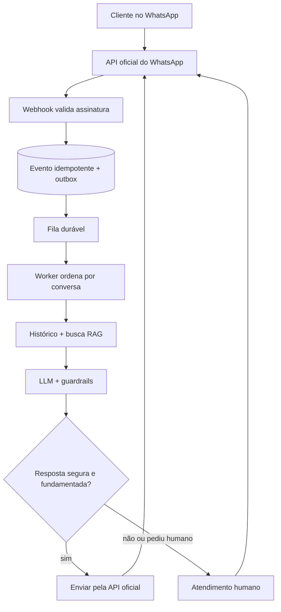
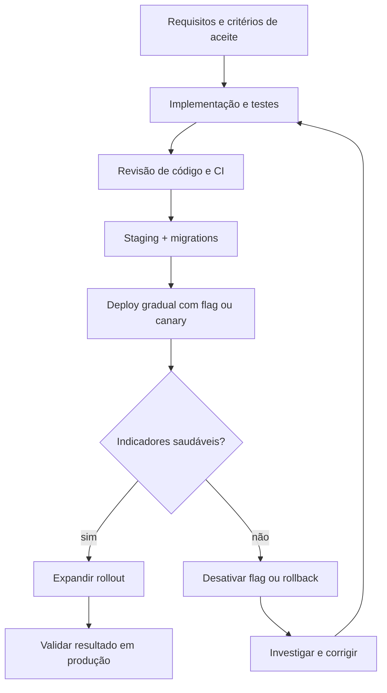
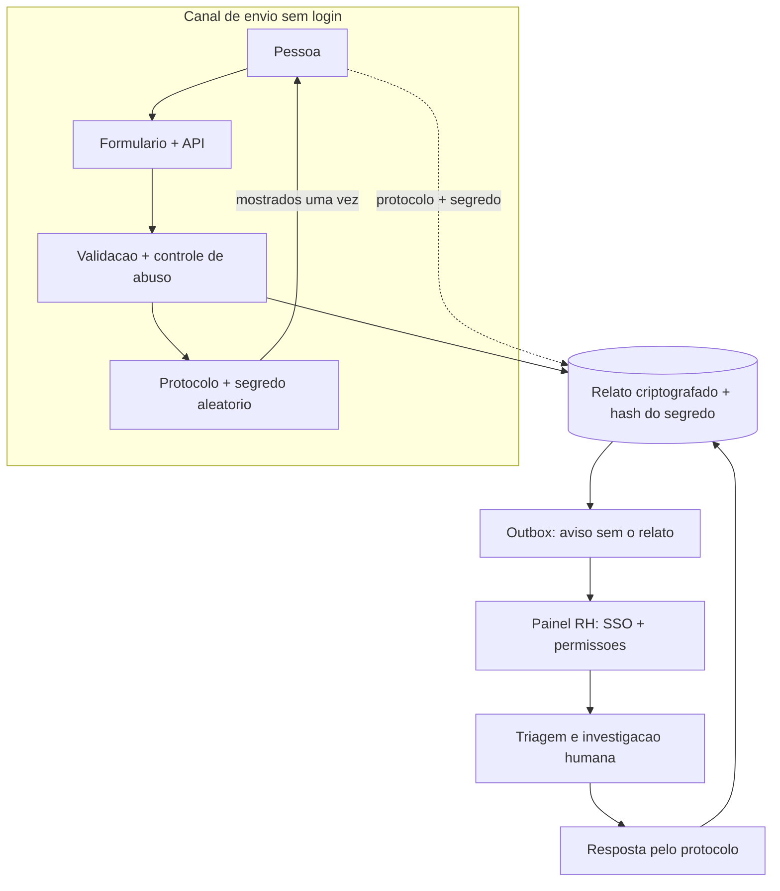

# Respostas: Avaliação Técnica

Respostas às três perguntas sobre chatbot de WhatsApp, entrega de features em produção e ouvidoria anônima de RH. As tecnologias citadas são exemplos; eu escolheria a stack final conforme o contexto, a equipe e os requisitos do produto.

## Sumário

1. [Chatbot de WhatsApp](#1-chatbot-de-whatsapp)
2. [Feature em produção](#2-garantindo-que-uma-feature-funcione-em-produção)
3. [Ouvidoria anônima de RH](#3-ouvidoria-anônima-de-rh)

---

## 1. Chatbot de WhatsApp

### Resposta resumida

Eu usaria a API oficial do WhatsApp Business Platform, evitando automações não oficiais que podem colocar o número em risco. O webhook validaria a assinatura e registraria cada evento de forma durável antes de responder rapidamente. Workers processariam as mensagens fora da requisição, com idempotência pelo identificador da mensagem e ordenação por conversa.

No processamento, carregaria apenas o histórico necessário, buscaria contexto em uma base de conhecimento com RAG e chamaria o modelo com instruções e limites claros. O bot responderia com base nas fontes recuperadas; quando não houvesse suporte suficiente, o assunto fosse sensível ou o cliente pedisse, encaminharia a conversa para uma pessoa.

### Stack e justificativa

| Camada | Opção de exemplo | Por quê |
|---|---|---|
| Canal | WhatsApp Business Platform / Cloud API | Canal oficial; reduz riscos associados a automações não oficiais |
| Webhook | FastAPI ou serviço equivalente | Validação do evento e resposta rápida |
| Fila e workers | Redis com fila durável ou serviço gerenciado | Processamento assíncrono, retries e isolamento de falhas |
| Estado | PostgreSQL | Histórico de conversa e estado operacional |
| Busca e IA | RAG, banco vetorial e LLM | Respostas ancoradas na base de conhecimento, com fontes recuperáveis |

### Arquitetura

Cliente no WhatsApp → API oficial → webhook que valida e persiste o evento → fila durável → worker por conversa → histórico e busca RAG → LLM com guardrails → resposta ou transferência para humano → envio pela API oficial.

### Webhook (validação, idempotência e fila)

Validaria a assinatura sobre o corpo original da requisição. Para evitar perda de mensagens, gravaria o evento com uma chave única, como o ID da mensagem, e uma tarefa de outbox na mesma transação; um publicador encaminharia a tarefa à fila. Só responderia sucesso depois da persistência durável. Assim, um retry do provedor não duplica o processamento, e uma falha momentânea da fila não faz o evento desaparecer.

### Worker (RAG, handoff e resposta)

O worker processaria mensagens em ordem por conversa, carregaria um trecho limitado do histórico, buscaria documentos relevantes e geraria uma resposta. Registraria o resultado e o estado antes ou junto do envio, com idempotência também na saída quando possível. Se faltassem fontes, houvesse baixa confiança validada por avaliações, uma solicitação explícita ou um tema sensível, encaminharia para atendimento humano em vez de improvisar.

### Pontos de atenção em produção

- **Regras do canal:** acompanhar janela de atendimento, templates aprovados e limites de envio conforme a política vigente da Meta.
- **Confiabilidade:** idempotência de entrada e saída, ordem por conversa, timeout, retry com backoff, fila de falhas e monitoramento dos provedores.
- **Qualidade e segurança:** avaliar alucinações, prompt injection e uso de ferramentas; tratar mensagens e documentos como dados não confiáveis; manter revisão humana em casos de risco.
- **Privacidade:** minimizar dados, definir retenção e exclusão, controlar acesso e mascarar informações pessoais nos logs, conforme a LGPD.
- **Operação:** acompanhar latência, erros, custo por conversa, resolução, transferências para humanos e satisfação; manter alertas e um conjunto de conversas de referência para avaliação contínua.

---

## 2. Garantindo que uma feature funcione em produção

### Resposta resumida

Eu começaria definindo o problema, os critérios de aceite, os casos de borda e como medir o resultado esperado. Depois verificaria impactos em segurança, privacidade, desempenho, integrações e compatibilidade com dados e clientes existentes.

Implementaria testes unitários para regras de negócio, testes de integração para banco, filas e contratos externos, e testes ponta a ponta para os fluxos críticos. No CI, executaria testes, lint, análise de tipos e verificações de dependências e segurança, além de revisão de código. Em staging, validaria o fluxo em configuração próxima à produção, incluindo migrations e plano de rollback.

### Caminho até a produção

Requisitos e critérios de aceite → implementação e testes → revisão e CI → staging → deploy gradual → acompanhamento de métricas → expansão do rollout ou rollback.

### Feature flag com rollout gradual

Quando fizer sentido, publicaria a implementação atrás de uma feature flag, inicialmente desligada. Liberaria para grupos pequenos e estáveis de usuários, ampliando gradualmente se os indicadores de erro, latência e negócio permanecerem saudáveis. A flag permite interromper a exposição rapidamente; ela não substitui rollback de código nem migrations compatíveis.

### Passos

1. **Requisitos claros:** critérios de aceite, cenários de falha e casos de borda definidos antes de codar.
2. **Testes:** unitários, integração e ponta a ponta proporcionais ao risco; uso de serviços isolados ou containers quando útil, sem depender apenas de mocks para contratos críticos.
3. **CI e revisão:** testes, lint, tipos, análise de segurança e revisão antes do merge.
4. **Staging:** ambiente semelhante à produção para validar fluxos, configurações, carga relevante e dependências.
5. **Migrations seguras:** mudanças compatíveis com versões antigas e novas do código; usar expand/contract quando necessário para que um rollback da aplicação não quebre o schema.
6. **Observabilidade:** métricas, logs, alertas, dashboard e procedimento de resposta preparados antes do deploy.
7. **Rollout:** feature flag ou canary em etapas, com comparação ao baseline e critérios explícitos para avançar ou interromper.
8. **Pós-deploy:** acompanhar erros, latência e métricas do produto; se houver regressão, desativar a flag ou reverter a versão e investigar a causa sem culpabilização.
9. **Limpeza:** após estabilidade, remover flags temporárias e código antigo com segurança.

---

## 3. Ouvidoria anônima de RH

### Resposta resumida

Eu separaria o envio do relato do acesso do RH. A pessoa enviaria um formulário sem login e sem campos de identificação obrigatórios. A API validaria e sanitizaria o conteúdo, aplicaria controles contra abuso e criaria um protocolo e um segredo aleatório de acompanhamento. O segredo seria mostrado uma única vez; no banco, guardaria apenas o hash. O relato seria criptografado em trânsito e em repouso, com as chaves fora do banco.

O RH receberia uma notificação sem o token e sem dados desnecessários do relato. No painel, usaria SSO, permissões por função e trilha de auditoria. Uma classificação automática de assunto ou urgência poderia apoiar a triagem, sempre como sugestão revisada por uma pessoa. A pessoa consultaria atualizações e responderia usando o protocolo e o segredo, sem criar uma conta.

### Princípio

O sistema não deve coletar identidade ou vínculo com a empresa para receber o relato. Ainda assim, não prometeria anonimato absoluto: o texto pode identificar alguém, e a infraestrutura ou os controles antifraude podem processar metadados. O objetivo é reduzir a associação técnica entre relato e autor, comunicar os limites e impedir que o RH tenha acesso a identificadores desnecessários.

### Fluxo de dados

Pessoa → formulário sem login → API e controles contra abuso → armazenamento criptografado + protocolo e hash do segredo → painel restrito do RH → resposta acessível com o protocolo e o segredo.

### Implementação

Ao receber o relato, criaria o caso e um evento de notificação em uma transação com outbox, para evitar que o caso seja salvo sem que o RH seja avisado. A notificação levaria apenas o protocolo e a prioridade necessária; o conteúdo seria acessado no painel autorizado. O token de acompanhamento teria alta entropia, seria armazenado somente como hash e seria exigido para consultar ou responder ao caso. Anexos, se permitidos, passariam por validação e remoção de metadados como EXIF.

### Decisões de anonimato e segurança

- **Coleta mínima:** sem login, e-mail ou nome obrigatórios; orientar a pessoa a evitar detalhes que a identifiquem se isso não for necessário.
- **Metadados e abuso:** evitar logs de conteúdo, IP e user-agent onde possível. Se um controle antifraude precisar de IP, limitar o uso e a retenção; até um hash temporário de IP pode ser dado pessoal e deve ser tratado com transparência.
- **Painel do RH:** SSO, acesso por função e necessidade de conhecimento, auditoria de leitura e alteração e notificações sem conteúdo sensível.
- **Triagem assistida:** automação pode sugerir categoria ou urgência, mas uma pessoa revisa; casos urgentes têm um fluxo de resposta claramente definido.
- **Proteção dos dados:** TLS, criptografia em repouso, gestão de chaves fora do banco, retenção e exclusão definidas e análise jurídica/LGPD.
- **Limites da anonimidade:** explicar que o conteúdo narrativo pode revelar a identidade e estabelecer medidas de proteção contra retaliação e acesso indevido.
